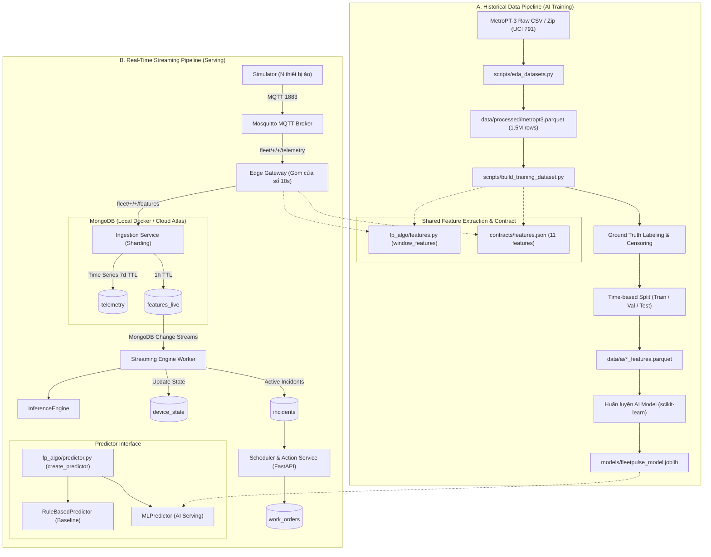

# KIẾN TRÚC PIPELINE DỮ LIỆU FLEETPULSE (BATCH & STREAMING)

Tài liệu chi tiết về kiến trúc hai luồng xử lý dữ liệu: **Historical Batch Pipeline cho AI** và **Online Streaming Pipeline cho Vận hành Thời gian thực**.

---

## 1. SƠ ĐỒ TỔNG THỂ HỆ THỐNG

---

## 2. NGUYÊN TẮC THIẾT KẾ: CHỐNG TRAINING-SERVING SKEW

Một trong những nguyên nhân phổ biến nhất khiến các mô hình AI dự báo hỏng hóc thất bại khi đưa vào sản xuất là **Training-Serving Skew** (sự sai lệch giữa cách tính đặc trưng lúc huấn luyện và lúc suy luận trực tiếp).

FleetPulse giải quyết triệt để vấn đề này qua 3 trụ cột:

1. **Một Nguồn Chân Lý Duy Nhất (Single Source of Truth):**
   Cả Batch Script (`scripts/build_training_dataset.py`) và Edge Gateway (`gateway/run.py`) đều gọi trực tiếp hàm `window_features(samples)` trong thư viện chuẩn `fp_algo/features.py`. Không duy trì hai đoạn code tính toán độc lập.

2. **Data Contract Nghiêm Ngặt (`contracts/features.json` & `fp_algo/contract.py`):**
   Mọi đặc trưng đều được ràng buộc về tên trường, kiểu dữ liệu, đơn vị đo, khoảng giá trị vật lý và thứ tự đầu vào (`FEATURE_ORDER`). Trước khi nạp vào Predictor, hàm `validate_features()` kiểm tra tính toàn vẹn của dữ liệu.

3. **Kiểm thử Đồng Đẳng (Parity Testing):**
   Bộ test `tests/test_feature_parity.py` chạy kiểm thử liên tục đảm bảo cùng một mảng mẫu cảm biến đầu vào sẽ sinh ra vector đặc trưng hoàn toàn trùng khớp với sai số số thực $\le 10^{-5}$.

---

## 3. KIẾN TRÚC LƯU TRỮ PHÂN TẦNG (HOT VS COLD)

FleetPulse tách bạch rõ ràng vai trò của hai tầng lưu trữ:

| Tiêu chí | Tầng Hoạt Động (Hot Store) | Tầng Lịch Sử & Huấn Luyện (Cold Store) |
| :--- | :--- | :--- |
| **Công nghệ** | MongoDB (Local Docker / MongoDB Atlas) | File Parquet nén Snappy |
| **Đường dẫn/Collection**| `telemetry`, `features_live`, `device_state` | `data/processed/`, `data/ai/` |
| **Mục đích** | Phục vụ Change Streams thời gian thực, dashboard trực quan và kích hoạt sự cố | Phục vụ huấn luyện mô hình học máy, phân tích tương quan và EDA |
| **Chính sách TTL** | `features_live`: 1 giờ; `telemetry`: 7 ngày | Lưu trữ vĩnh viễn, chia version theo thời gian |
| **Định dạng dữ liệu** | Tài liệu BSON linh hoạt, Time Series chuyên dụng | Cột (Columnar) nén tối ưu I/O cho DataFrame |

---

## 4. CƠ CHẾ PHÂN SHARD VÀ PHỤC HỒI LỖI

- **Gán Shard Nhất Quán (Deterministic Sharding):**
  Tại Ingestion Service, mỗi thiết bị được phân vào shard cố định bằng thuật toán CRC32 không phụ thuộc seed của Python runtime:
  $$\text{shard\_id} = \text{crc32}(\text{deviceId}) \pmod{N_{\text{shards}}}$$
- **Linh Hoạt Trong Vận Hành:**
  - **Môi trường Dev / Demo:** Chạy 1 worker duy nhất với tham số `--shard all` để bao quát 100% thiết bị ảo mà không lo sót dữ liệu.
  - **Môi trường Production:** Khởi động $N$ workers tương ứng với từng `--shard 0`, `--shard 1`,... trên các container độc lập để mở rộng quy mô xử lý song song.
- **Tính Idempotent (Chống trùng lặp):**
  Tất cả các lệnh ghi vào `features_live` và `device_state` đều sử dụng `upsert=True` với khóa tự nhiên `(deviceId, windowStart)` hoặc `deviceId`, đảm bảo việc worker khởi động lại hoặc đọc lại Change Stream không tạo bản ghi rác.
